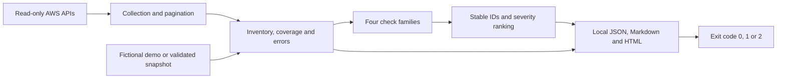

# Python AWS Security Posture Scanner

[](https://github.com/Srujal-Y/Python-AWS-Security-Posture-Scanner/actions/workflows/ci.yml)

**Python 3.11+ · boto3 · IAM · S3 · EC2 Security Groups**

A read-only Python CLI that turns AWS configuration metadata into a local security review. It checks public S3 exposure, IAM users without MFA, broad IAM permission policies, and open EC2 security-group rules.

Each finding includes a stable ID, affected resource, region, severity, evidence, risk explanation and remediation guidance. JSON supports further analysis; Markdown and a standalone HTML report support human review. There is no dashboard, email integration or automatic remediation.

**Run the demonstration without an AWS account, credentials, Docker or paid services.** The included resources are fictional and every demo report says so.

| Validation | Recorded result |
| --- | --- |
| Automated local tests | 75 passed |
| Hosted GitHub Actions | [Passed on Python 3.11 and 3.14](https://github.com/Srujal-Y/Python-AWS-Security-Posture-Scanner/actions/runs/39401294352) |
| Combined statement/branch coverage | 97.87% |
| Runtime dependency audit | No known vulnerabilities at the recorded audit date |
| Distribution | Source archive and wheel built; installed CLI tested in an isolated environment |
| Live AWS account validation | Pending authorised AWS access |

See [validation evidence](docs/VALIDATION.md) for dates, commands and limits. The CI badge shows the current hosted workflow status.

## Quick start

Prerequisites: Python 3.11 or newer and Git. Dependency installation needs internet access; running the installed offline demo does not.

### Windows PowerShell

```powershell
git clone https://github.com/Srujal-Y/Python-AWS-Security-Posture-Scanner.git
cd Python-AWS-Security-Posture-Scanner
python -m venv .venv
.\.venv\Scripts\python.exe -m pip install -r requirements.txt -r requirements-dev.txt
.\.venv\Scripts\python.exe -m pip install -e . --no-build-isolation --no-deps
.\.venv\Scripts\python.exe -m posture_scanner demo --output reports/demo --fail-on none
Start-Process .\reports\demo\report.html
```

If you already have the project locally, start with `python -m venv .venv` from its folder. No environment activation or PowerShell execution-policy change is required.

### Linux / macOS

```bash
git clone https://github.com/Srujal-Y/Python-AWS-Security-Posture-Scanner.git
cd Python-AWS-Security-Posture-Scanner
python3 -m venv .venv
.venv/bin/python -m pip install -r requirements.txt -r requirements-dev.txt
.venv/bin/python -m pip install -e . --no-build-isolation --no-deps
.venv/bin/python -m posture_scanner demo --output reports/demo --fail-on none
```

Open `reports/demo/report.html` in a browser. The recorded local validation used Python 3.14.2 on Windows; the hosted workflow targets Python 3.11 and 3.14.

The demonstration produces **13 findings: 2 critical, 7 high, 3 medium and 1 low**. It also includes protected resources that should produce no finding, including public S3 grants suppressed by account controls, an IAM user with MFA, and an unconditional deny-all policy.

You can open the committed [sample HTML report](examples/demo/report.html), [Markdown report](examples/demo/report.md), or [JSON report](examples/demo/report.json) directly. GitHub displays HTML source; download the HTML file and open it locally to view the formatted report.

## What it checks

| Family | Observations | Important distinction |
| --- | --- | --- |
| Public S3 exposure | Bucket ACL global grants and S3 `IsPublic` policy status; bucket and account Block Public Access | Controls that block new public writes differ from controls that restrict existing public access |
| IAM MFA | Registered MFA devices and console login-profile presence for IAM users | Enrollment does not prove MFA enforcement; workload users need different remediation |
| IAM policies | Attached managed permission policies and user, role and group inline policies | Broad grants are review candidates; the scanner does not calculate effective permissions |
| Security groups | Universal IPv4/IPv6 ingress, sensitive port ranges, all-protocol ingress and unrestricted egress | An open rule does not prove that an attached workload is reachable from the internet |

See the [check catalogue](docs/CHECKS.md) for severity rules, exclusions and AWS references.

## How it works



Collection, detection and reporting are separate modules. AWS reads use bounded retries and timeouts. Pagination retains earlier observations if a later page fails, and the affected scope is marked partial. Detection functions can be tested independently of AWS credentials.

### Report contents

| Output | Purpose |
| --- | --- |
| `report.json` | Schema-validated findings for programmatic review |
| `report.md` | Readable evidence suitable for a local review record |
| `report.html` | Standalone browser report with no scripts or external assets |

Each report includes the account, regions, scan ID, timestamps, coverage, collection errors, severity totals and assessment limits. Each finding contains `id`, `check_id`, `family`, `resource`, `region`, `issue`, `severity`, `risk`, `remediation`, `evidence` and `confidence`.

Severity order is **critical → high → medium → low → informational**. Ratings are review heuristics, not CVSS scores or compliance determinations. Reusing an output directory replaces its report files; choose a new directory when retaining evidence.

## Run against AWS when access is available

Have an account administrator review [the scanner's read-only IAM policy](iam/scanner-read-only-policy.json) and attach it to an authorised scanning role. Use your organisation's normal AWS profile/SSO process. The scanner uses boto3's credential provider chain and stores no credentials in the project.

```powershell
.\.venv\Scripts\python.exe -m posture_scanner scan `
  --profile security-review `
  --regions eu-west-1 me-central-1 `
  --output reports/aws-review
```

EC2 checks run only in the named regions. IAM and general-purpose S3 bucket discovery are account-wide. Run separately with the authorised profile for each account; there is no organisation-wide role traversal.

The scanner only invokes read APIs. It does not provision resources, modify policies, open ports, retrieve object contents, create credentials or send reports. **No live AWS scan has been performed for the included validation evidence.**

### Exit codes

| Code | Meaning |
| --- | --- |
| `0` | Coverage is complete for the declared scope and no finding meets the chosen failure threshold |
| `1` | Coverage is complete and a finding meets or exceeds the threshold |
| `2` | Collection is incomplete, credentials/input are invalid, or report writing fails |

Default threshold: `--fail-on high`. Other choices: `critical`, `medium`, `low`, `informational`, `none`. `none` disables severity failure but **never** makes partial coverage pass. A default demo run returns `1` because its intentional findings meet the threshold.

“Complete” describes collection coverage for these checks, not a secure account, regulatory compliance or absence of other vulnerabilities. An inaccessible resource is recorded as incomplete; it is never silently treated as safe.

## Review a local inventory

```powershell
.\.venv\Scripts\python.exe -m posture_scanner snapshot `
  --input src/posture_scanner/data/demo.json `
  --output reports/snapshot `
  --fail-on none
```

Snapshots must match the [inventory schema](src/posture_scanner/data/inventory.schema.json), declare all four families and include coverage for every requested EC2 region. Unknown observations must be declared as incomplete. Snapshot metadata is explicitly labelled as unverified. The live command does not export an inventory snapshot.

## Validate the project

```powershell
.\.venv\Scripts\python.exe scripts/verify.py
# Separate network-backed dependency advisory check:
.\.venv\Scripts\python.exe -m pip_audit -r requirements.txt --strict --disable-pip --no-deps
```

The verification script runs dependency consistency checks, lint/format checks, tests with branch coverage, package builds and the offline demo. Tests cover AWS responses using botocore Stubber, pagination, denied reads, MFA uncertainty, IAM policy logic, IPv6, report escaping and exit codes. CI runs these checks on Python 3.11 and 3.14 with no AWS credentials.

The GitHub workflow also audits runtime dependencies, builds the distribution and smoke-tests the installed wheel. It uses read-only repository permissions and uploads test evidence and fictional demo artifacts without AWS credentials.

For CLI options, run `python -m posture_scanner --help` using the virtual environment's Python.

## Design and operating guides

- [Architecture and trust boundaries](docs/ARCHITECTURE.md)
- [Check catalogue and severity decisions](docs/CHECKS.md)
- [Operational runbook and review workflow](docs/OPERATIONS.md)
- [Security and data handling](SECURITY.md)

```text
src/posture_scanner/
  collector.py       Read-only AWS metadata collection and coverage
  checks.py          Pure, independently testable detection logic
  models.py          Inventory, stable finding identity and exit policy
  reporting.py       JSON, Markdown and standalone HTML reports
  cli.py             Scan, snapshot and demo commands
  data/              Versioned input/output schemas and fictional inventory
tests/               Detection, AWS stub and CLI/report tests
iam/                 Explicit read-only API permission policy
examples/demo/       Fictional sample outputs
docs/                Design, operations, checks and validation evidence
.github/             Credential-free CI and dependency update configuration
```

## Scope and data handling

Coverage excludes root/federated-user MFA, object ACLs and S3 access points, effective IAM permission calculation, organisation-wide account traversal, and network reachability analysis. There is no dashboard, email integration or automatic remediation.

Live reports contain sensitive configuration metadata. Store them in an approved location and review staged files before publishing. `reports/`, credential files and local environments are ignored by Git; committed examples contain fictional resources only.

Live AWS validation, independent security review and an organisation's operational approval are separate steps before production adoption.

## License

[MIT](LICENSE).
