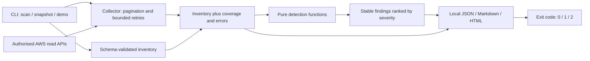

# Architecture

The collector, rules and reporting are separate so AWS access failures cannot be confused with check outcomes, and detection behaviour can be tested without credentials.

## Collection boundaries

STS establishes the account and partition before collection. If identity cannot be established, every family is marked `not_run` and the overall report is `partial`.

Each family has a coverage entry. Security-group coverage has one entry per selected region. AWS discovery uses SDK paginators where supported. If a later page fails, already observed resources remain available, but the scope becomes partial. Per-resource failures record the operation, affected resource and sanitised AWS error code; they do not include raw exception text.

SDK retries use standard mode with at most four total attempts, a five-second connection timeout and a fifteen-second read timeout. These are per-request limits, not a whole-scan deadline. Collection is sequential to keep behaviour understandable and avoid unnecessary API concurrency. Large accounts can take time to complete.

S3 location discovery selects a client in each bucket's region. `ExpectedBucketOwner` binds bucket reads to the identified account. IAM APIs are global within the selected partition. Managed policies are inspected at their current default version; only attached permission policies are selected. Inline policies are read from users, roles and groups.

Snapshots use a versioned JSON schema and additional semantic checks for declared coverage, CIDR address families and port ranges. A snapshot is not proof that its data matches an AWS account.

## Finding contract

The output schema is `data/report.schema.json`. Each finding has:

- `id`: a 20-character SHA-256-derived identifier based on check, resource, region and rule qualifier.
- `check_id`, `family`, `resource`, `region`, `issue`.
- `severity`: critical, high, medium, low or informational, in descending order.
- `risk`, `remediation`, `evidence`.
- `confidence`: observed configuration or a candidate requiring contextual review.

Duplicate IDs are collapsed and rows are sorted by severity, resource, check and ID. Security-group rule IDs use protocol, port range, direction and canonical CIDRs, so rule list ordering does not change them. IAM statement IDs include the statement index; reordering a policy can change those IDs. IDs are useful for review comparison, not a persistent case-management system.

Run IDs and UTC timestamps identify the report run. They do not establish cryptographic provenance or authenticity. The JSON summary is computed from the emitted findings.

## Local output trust boundary

Reports remain in the requested output directory. HTML uses escaped metadata, no scripts or external assets, and a restrictive Content Security Policy. Markdown escapes metadata in prose and uses indented code blocks for JSON evidence. The report viewer must still be a trusted local application.

Each output file is written to a temporary file in the destination and atomically replaced. The set of three files is not a single transaction: a failure partway through writing can leave files from different runs. Check `scan_id` and command exit status before accepting a report set. Reusing an output directory replaces earlier files; use a unique directory when preserving evidence.

No report encryption, signing, remote upload, dashboard, email delivery or automated remediation is implemented.

## Failure model

| Event | Behaviour |
| --- | --- |
| Missing/expired credentials | Partial report, error code, exit 2 |
| Denied bucket/identity/group read | Retain other observations, mark affected scope partial |
| Missing S3 block configuration | Known absent block configuration, not an access-denied error |
| IAM user has no login profile | Console password known absent |
| MFA read denied | MFA count remains unknown; no invented missing-MFA finding |
| Invalid local snapshot | Reject before report generation, exit 2 |
| Threshold breached | Preserve all reports, exit 1 |
| Incomplete scan with `--fail-on none` | Preserve partial report, exit 2 |
| Report I/O failure | Return exit 2; earlier output files may remain |

Coverage means the implemented API scope was observed without a recorded collection failure. It cannot establish that a policy hiding resources, an unsupported resource type or an omitted region is safe.
